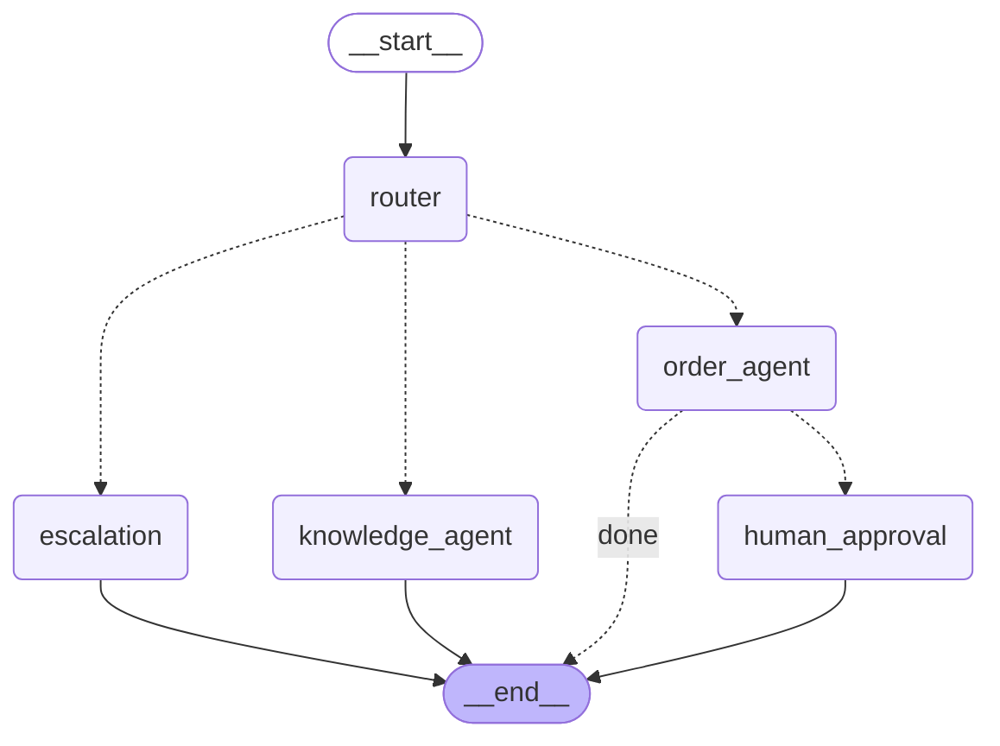

# Reliable LangGraph Support Agent

A LangGraph support agent built around reliability engineering, not just prompt orchestration:
a router/supervisor graph, a retrieval (FAQ) agent, an order-tool agent wrapped in retry/timeout/
circuit-breaker, a human-approval gate for risky actions, persistent conversation state, and an
evaluation harness that checks routing/escalation correctness against a labeled scenario set.
Independent portfolio reference implementation by Raghu Sharma; not represented as client work.

## Architecture



This exact diagram is also served live at `GET /graph/diagram` (rendered via LangGraph's own
`get_graph().draw_mermaid()`), so it can never drift from the real compiled topology — see
`src/support_agent/graph/build.py`.

## What it demonstrates

- **Router/supervisor node** with a pluggable `Classifier`: a dependency-free `RuleBasedClassifier`
  (deterministic keyword/FAQ-overlap matching, what every test in this repo runs against) and a
  real `LLMClassifier` behind the same interface, used automatically when `OPENAI_API_KEY` is set.
- **Retrieval agent** (`knowledge_agent`) answering from an FAQ knowledge base.
- **Order-tool agent** looking up, refunding, or cancelling orders against a mock order API.
- **Human-approval interrupt node**: refunds and cancellations pause the graph via LangGraph's
  `interrupt()` before any mutating call — the caller resumes with an explicit approve/deny, and
  the mutating tool call only happens after approval, never twice even though the node re-runs
  from the top on resume (see `graph/human_approval.py`'s docstring for why that's safe here).
- **Retries, timeouts, circuit breaker, and fallback replies** around every order-API call
  (`resilience.py`) — composed once in `call_with_resilience()`, reused by both the order agent
  and the approval node so there's exactly one place this logic lives.
- **Structured output validation**: every node boundary passes through a Pydantic model
  (`schemas.py`) — a router decision, a tool result — not a free-form dict.
- **Escalation on low confidence**: the router's confidence, not just its route guess, gates
  whether a message reaches an agent at all or goes straight to "connect me with a human."
- **Persistent conversation state**: `AsyncSqliteSaver` checkpoints every thread to a local
  SQLite file, so conversation history and pending approvals survive a process restart — not
  just an in-memory dict.
- **Tracing**: every node appends its own timing to `state["trace"]`, which — because LangGraph
  persists state per thread across the interrupt/resume boundary — shows the *entire* round trip
  in one trace, including the pause for approval.
- **A routing-correctness evaluation harness** (`eval/scenarios.jsonl` + `evaluation.py`, exposed
  at `GET /eval/run` and in the chat UI): checks that each labeled message hits the expected
  route, triggers approval when it should, and escalates when it should — run through the real
  compiled graph, not a parallel reimplementation.
- **FastAPI backend + a simple vanilla-JS chat UI** (`static/index.html`) with inline
  approve/deny buttons for pending actions and a one-click eval run.

## Quickstart

```bash
python -m venv .venv && source .venv/bin/activate
pip install -e '.[dev]'
uvicorn support_agent.app:app --reload
```

Open http://localhost:8000 for the chat UI. Try:

- `How do I track my order?` — knowledge agent
- `What is the status of ORD-1001?` — order agent, direct answer
- `I want a refund for ORD-1002` — order agent → human-approval interrupt
- `asdkfj random gibberish` — low confidence → escalation

Demo order ids: `ORD-1001`, `ORD-1002`, `ORD-1003`.

Set `OPENAI_API_KEY` to switch the router from `RuleBasedClassifier` to the real
`LLMClassifier` — no other code change needed (`config.py` / `graph/build.py`).

## API

| Method | Path | Purpose |
|---|---|---|
| `POST` | `/chat` | `{"thread_id", "message"}` → a reply, or `{"status": "awaiting_approval", "approval": {...}}` |
| `POST` | `/chat/resume` | `{"thread_id", "approved"}` → resumes a paused approval |
| `GET` | `/graph/diagram` | The compiled graph's Mermaid diagram |
| `GET` | `/eval/run` | Runs `eval/scenarios.jsonl` against a fresh isolated graph, returns pass/fail per scenario |
| `GET` | `/health` | Health check |

## Tests

```bash
pip install -e '.[dev]'
pytest -q      # 66 tests — no live API key, no real order backend, no network calls
ruff check .
```

Every test runs against `RuleBasedClassifier`, `MockOrderApiClient`, and a `MemorySaver`
checkpointer — `LLMClassifier` is separately tested with a mocked HTTP transport
(`tests/test_router.py`), same pattern as the sibling `rag-quality-workbench` project's provider
tests.

## Known limitations, stated plainly

- `RuleBasedClassifier` is a real, tested heuristic, not a language model — it gets the demo
  scenarios right (see `eval/scenarios.jsonl`, 11/11), but a production deployment handling
  open-ended phrasing would want `LLMClassifier` (or a fine-tuned classifier) as the default,
  not just an opt-in.
- The mock order API is in-memory and single-process; a real deployment's `MockOrderApiClient`
  swap-in would need its own connection pooling/auth, which this reference doesn't model.
- `CircuitBreaker`'s HALF_OPEN state doesn't serialize concurrent probes to exactly one in-flight
  call — documented in `resilience.py`, and fine for a single-agent-per-conversation workload,
  not for high concurrency without adding a lock.
- The chat UI is deliberately plain (vanilla HTML/JS, no framework) — the point of this repo is
  the graph/reliability engineering, not frontend polish (the sibling `rag-quality-workbench`
  project is where the Next.js UI investment went).

## License

MIT
